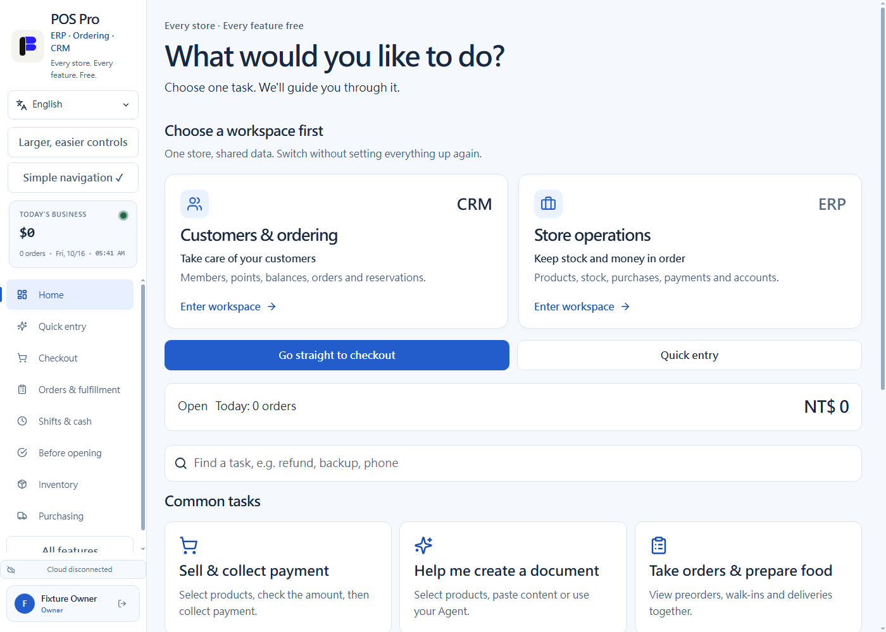
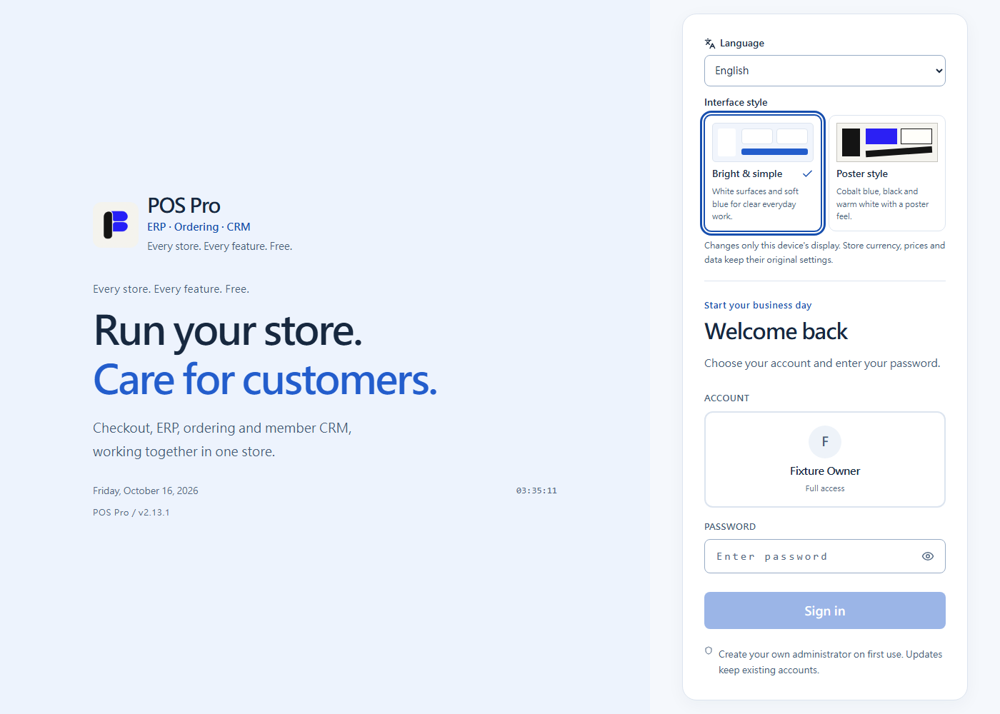
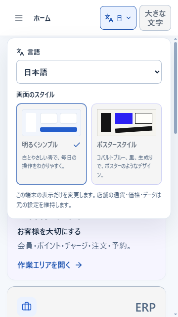
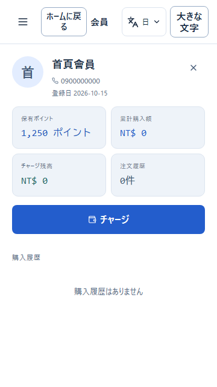
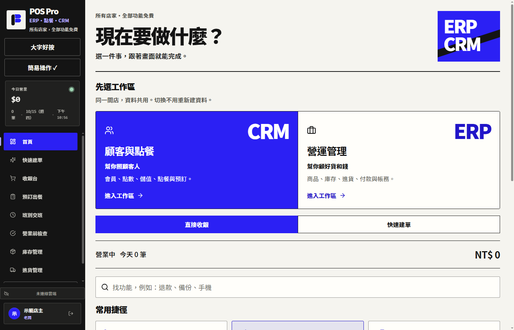
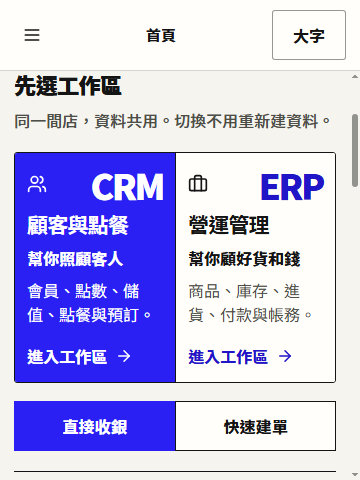
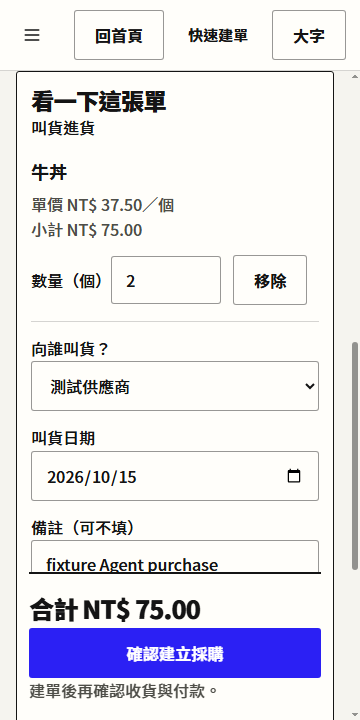
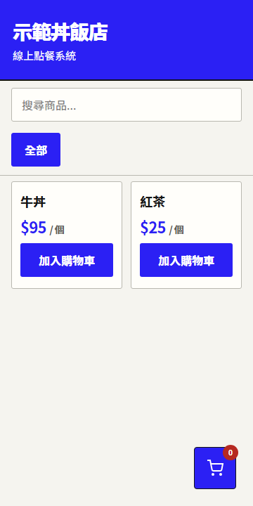

<p align="center">
  
</p>

<h1 align="center">POS Pro｜ERP・點餐・CRM</h1>

<p align="center">
  所有店家，全部功能免費。從收銀升級為 ERP、點餐與 CRM 整合營運系統。<br>
  收銀 · 預訂出餐 · 採購與應付 · 庫存 · 會員 · 會計 · Agent 快速建單<br>
  <i>Free, offline-first ERP, ordering and member CRM · Windows desktop + shared-store mobile · 繁體中文 / English / 日本語 / 简体中文</i>
</p>

<p align="center">
  
  
  
  
</p>

---

[English quick start](docs/QUICK_START.en.md) · [日本語ガイド](docs/QUICK_START.ja.md)

## 這是什麼

目前版本：v2.15.0。產品以 **POS Pro｜ERP・點餐・CRM** 呈現，從收銀延伸到採購與應付、庫存會計、顧客點餐與預訂出餐、會員經營。保留海報風格，也可切換明亮簡約與四語介面。Agent 回覆貼上就能核對單價與數量，缺少資料會引導補填；離開或重新載入後可接回同一張未完成草稿。完整 ERP 與 CRM **持續開發中**，多倉批次、關帳稅務、人事薪資、完整商機管理等仍有未完成能力，見 [完整目標清單](product-capabilities.json)。本機交付與限制見 [2.15.0 安裝說明](docs/INSTALLER_2_15_0.md)。

2.15.0 新增「客戶與款項」：客戶只建一次，可先收款、保留餘額，再把同一筆款項抵付多張交付請款。部分解除、原方式退款及更正都保留原紀錄，桌面和配對手機共用同一份帳本。Agent 可以先填收款草稿，仍由店主確認實際款項；回覆中斷時保留原編號，避免舊草稿變成第二筆收款。見 [簡單操作指南](docs/CUSTOMER_GUIDE.md)。

| 整合範圍 | 目前提供的主要流程 |
| --- | --- |
| ERP 日常營運 | 收銀、庫存、採購應付、客戶銷售應收、退貨退款、複式帳務與報表 |
| 點餐與出餐 | 顧客掃碼點餐、店員登記預訂／現場／外送、原料預留、收款及交付 |
| 會員 CRM | 會員檔案、點數與分級、儲值、生日提醒、RFM 客群分析 |

提供可切換的 **明亮簡約** 與原有 **海報風格**，登入前即可點風格預覽卡，手機頂端也能切換。繁體中文、English、日本語、简体中文會依裝置語言起始，手動選擇依裝置保存。2.14.1 補齊會員統計、促銷條件、同步時間與畫面日期的語系顯示，改善手機會員詳情與返回操作。切換會保留購物車、Agent 草稿與未完成輸入，商品名稱、售價、TWD 幣別和帳本不改寫。翻譯仍待母語者校對，詳見 [語言與外觀](docs/LANGUAGE_AND_STYLE.md)。

2.14.1 將完整安裝檔驗證接入正式建置指令；自動檢查解包內容，並啟動交付程式完成交易、復原與重啟核對，通過後才回報成功。見 [建置與驗證](docs/BUILDING_AND_VERIFICATION.md)。

2.14.0 加入還原預覽、還原前完整保護副本及「資料復原」引導。查不到舊收款時會保留原單號，協助找回正式紀錄；已有新營運資料時保留兩份帳本供核對。見 [復原指南](docs/RECOVERY_GUIDE.md)。

2.13.0 接通「銷售與應收」：客戶同意報價後直接帶入銷售單，依下一步處理分批交貨、部分收款、退貨折讓與原收款退款。接單不扣庫存或收款；交付才認列應收，收款不再重複記營收。四語畫面、總帳報表、完整備份與私人共用店面沿用同一份正式回執。見 [傻瓜操作指南](docs/SALES_GUIDE.md)。完整 ERP 範圍仍持續開發。

2.12.0 新增「報價與價目表」：三步開立客戶專屬報價、各客戶單價分開記住、保留修訂歷史，並可下載勾選商品的一般售價目錄。收到報價後由買方核對建立採購，不自動入庫或付款。格式公開，可由其他 ERP／Agent 使用；檔案沒有身份簽章或加密，詳見 [使用流程與協議](docs/BUSINESS_EXCHANGE.md)。







首頁可先選「顧客與點餐（CRM）」或「營運管理（ERP）」；前者幫你照顧客人，後者幫你顧好貨和錢。兩個工作區共用同一間店的資料，保留直接收銀與快速建單，不必先理解專有名詞。

POS Pro 的產品原則是**所有店家、全部功能免費**，不限規模與店型，不設訂閱或進階功能解鎖費。資料預設存在本機（桌面版走 SQLite、獨立瀏覽器版走 localStorage）；配對手機直接使用店面電腦同一個資料庫。雲端同步是選用。

已提供攤販、餐飲外帶、零售／手作的情境起步，以及丼飯試賣演練。正式餐飲流程可登記預訂、現場與外送單；LINE 自動接單、外部外送平台串接仍在規劃。所有新模組沿用相同免費政策，外部平台的費用與配額另行清楚標示。

## 讓建單少一點步驟

1. 在「快速建單」說出品名數量，或按商品；需要 Agent 時，一鍵複製這次需要的建單資料。
2. 貼上 Agent 的完整回覆，直接看單價、數量與合計。缺資料就按「下一步」補填，不用找哪個欄位漏了。
3. 確認後才建單。收款、收貨、付款各有明確確認；結果未確認時鎖定原單，沿用原編號核對。

這個裝置會保留未完成草稿，依店面、帳號與角色隔離；正式訂單與庫存仍由店面資料庫負責。詳細範圍見 [Agent 建單協議](docs/AGENT_DOCUMENT_PROTOCOL.md)。

## 產品方向與開發依據

- [全功能免費產品規格](docs/FREE_POS_PRODUCT_SPEC.md)：免費政策、各店型流程、離線與資料保存要求。
- [開發與驗收清單](docs/FREE_POS_BACKLOG.md)：先確保交易保存與復原，再完成各店型起步及接單能力。
- [order-linebot 學習紀錄](docs/ORDER_LINEBOT_LEARNING.md)：來源版本、可採用設計、實驗結果與第三方成本查核。
- [第一個情境模板：丼飯外帶](docs/SCENARIO_TEMPLATES.md)：套用菜單、正式接單與獨立試賣演練。
- [正式預訂與出餐](docs/RESTAURANT_WORKFLOW.md)：原料／包材預留、產能、取餐號、收款、交付、取消退款與完整復原。
- [營業可靠性驗收](docs/OPERATING_READINESS.md)：已執行範圍、實機待驗項目及使用限制。
- [簡易工作台與完整 ERP 目標](docs/EASY_WORKSPACE.md)：從要做的事開始、一鍵交給 Agent，以及尚未完成的全產品能力。
- [手機與電腦共用店面](docs/SHARED_STORE.md)：電腦資料庫、私人區網 HTTPS、一次性配對、帳號權限與斷線核對。
- [ERP 採購到付款](docs/ERP-FOUNDATION.md)：分批收貨、請款核對、分次付款、沖銷與帳務；保留免費政策及已驗證能力界線。
- [Agent 快速建單協議](docs/AGENT_DOCUMENT_PROTOCOL.md)：同一入口支援文字、點選商品與 Agent 草稿，預覽後一次建單。
- [跨公司交換與採用理由](docs/BUSINESS_EXCHANGE.md)：其他公司的 Agent 可輸出開放 JSON；品項對照記住後同店面裝置共用。

正式預訂可由店員登記預訂、現場或外送單；LINE 自動接單與外部外送平台串接仍在後續規劃。

## ✨ 功能

- 🧾 **收銀** — 條碼掃描、混合付款、找零、退貨（自動沖庫存/點數）、掛單、收據
- 🍚 **預訂出餐** — 成品或配方原料預留、分時產能、每日取餐號、出餐狀態、全額收款與取消退款
- 📱 **共用店面** — 私人區網 HTTPS 配對，手機與電腦使用同一個 SQLite 資料庫
- 📦 **庫存** — 即時扣庫、安全庫存提醒、批量改價、CSV 匯入匯出、商品變動歷史、過期警示
- 👥 **會員** — 點數、分級、儲值卡、生日提醒、RFM 自動分群
- 🚚 **進貨訂貨** — 廠商管理、依供應商一鍵建單、依歷史銷售與庫存提出補貨建議、歷史單價
- 📒 **採購帳務** — 不超收的分批收貨、供應商請款、到期與欠款、銀行／班次現金分次付款、原付款沖銷
- ↩️ **採購退貨** — 未請款／已請款部分退貨、供應商待退、分次退款與保留歷史的更正
- ✨ **快速建單** — 貼上 Agent 回覆直接核對、商品搜尋、單價小計、缺資料引導、未完成草稿復原、跨公司品項對照與大字模式；銷售先帶入購物車，預訂與採購確認建立
- 🧮 **複式記帳** — 銷售/成本/儲值自動入帳、損益表、資產負債表、日記帳、CSV 匯出
- 📊 **報表** — 每日營收、毛利、熱賣滯銷、客單價、員工績效
- 📱 **顧客掃碼點餐**　☁️ **雲端同步（Supabase，選用）**　🔔 **Discord / Slack 通知（選用）**

## 📸 截圖

桌面首頁與登入、手機工作區及顧客點餐，皆為本版隔離示範資料。



<p>
  
  
  
</p>

[品牌與視覺規格](docs/BRANDING.md)

## 🚀 安裝

### 一般使用者
到 [Releases](https://github.com/Hao0321/pos-pro/releases) 下載 `POS Pro Setup x.x.x.exe`，安裝即可（Windows 10 / 11）。

舊 Releases 的安裝檔未經程式碼簽章。這次修正的原始碼與歷史安裝檔需分開驗證；不要只憑檔名判斷版本或來源。

首次啟動由你建立管理員名稱與至少 8 字元密碼。既有帳號會保留；舊的短密碼必須在驗證後更換，登入流程不再重建預設帳號。

最新版的本機產物與更新方式見 [2.15.0 安裝檔說明](docs/INSTALLER_2_15_0.md)；[2.14.1 安裝檔紀錄](docs/INSTALLER_2_14_1.md)保留供升級前回退。桌面安裝及資料目錄沿用 POS Pro，既有店面不因品牌更新而切換資料目錄。

### 自行編譯 / 開發

需要 Node.js 24 或更新的受支援版本。桌面版原生 SQLite 套件會依 Electron 版本重建。

```bash
npm install
npm run dev            # 瀏覽器開發伺服器 (localhost:5173)
npm run electron:dev   # 桌面版（Electron）開發
npm run electron:build # 打包 Windows 安裝檔 → release/
npm test               # 單元測試 (vitest)
npm run test:native    # 隔離的真實 SQLite 交易／備份驗證
npm run test:desktop   # 隱藏測試視窗，驗證實際 preload／IPC／收款畫面
```

## ☁️ 雲端同步（選用）

現有雲端功能提供手動上傳／下載資料快照；需依 [SETUP_SUPABASE.md](SETUP_SUPABASE.md) 設定 Auth 與權限後另外驗收。這不是共同交易來源。開發版的「共用店面」讓配對手機直接使用電腦的資料庫，無須訂閱雲端服務；一般獨立瀏覽器入口仍各自保存資料。已有 Supabase 專案需重跑更新後的 schema，保留儲值班別與會員／活動備註欄位。

手機入口、營業前檢查、本輪可靠性修正與實機驗收邊界見 [營業可靠性與手機操作](docs/OPERATING_READINESS.md)。

## ⚠️ 安全須知

- 桌面版在主程序驗證帳號、IPC 來源和角色。瀏覽器版角色控制適用於受信任的本機使用者，無法防止有權操作開發者工具或本機檔案的人修改資料。
- [`supabase/schema.sql`](supabase/schema.sql) 啟用 Auth 身份與 RLS；公開 key 本身不授權讀寫資料。員工密碼留在本機，不再同步到雲端。已有雲端專案需依 [設定指南](SETUP_SUPABASE.md) 更新後驗收。
- 收款需開班、資料核算及保存回覆；結果不明時請查詢原單號。電子付款只是記錄付款方式，沒有代替銀行或支付平台扣款。
- 瀏覽器資料使用一份原子紀錄，單一編輯分頁與交易鎖；需新版瀏覽器及 HTTPS／localhost。定期匯出完整備份到裝置之外。
- 對外點餐通道預設關閉；區網菜單只公開商品展示欄位，每筆顧客訂單須帶自己的追蹤憑證查詢。
- 本次驗證範圍與尚未測量的部分見 [弱點掃描與修正紀錄](docs/SECURITY_SCAN_20261007.md)。

## 🧱 技術

Electron 44 · better-sqlite3 13 · React 18 · Vite 8 · Supabase（選用）· Vitest 5

資料層由 [`src/utils/dataAccess.js`](src/utils/dataAccess.js) 抽象：桌面走 SQLite、瀏覽器走 localStorage，UI 共用一套。

## 📝 授權

[MIT](LICENSE) © 2026 Chroma Street Studio
